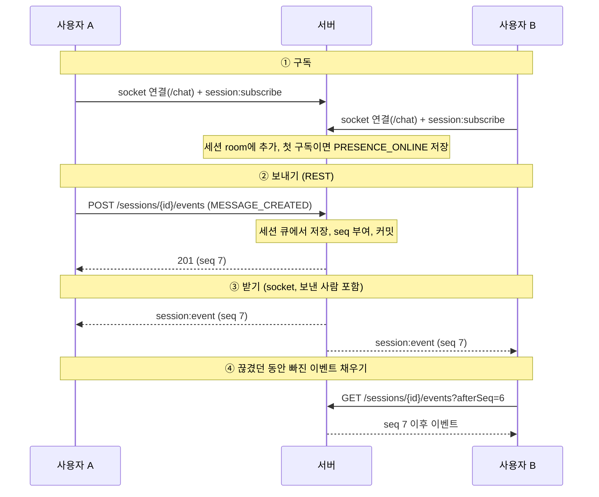

# chatting

1:1 참여자 간 실시간 채팅 서비스. 세션 단위로 이벤트를 기록하고, 이벤트를 다시 적용해 특정 시점의 세션 상태를 복원한다.

상세 설계는 아래 문서를 참고한다.

| 문서 | 내용 |
|---|---|
| [docs/api.md](docs/api.md) | REST API, 응답 형식, 실시간(socket.io), 순서 처리 기준 |
| [docs/db.md](docs/db.md) | ERD, 테이블 DDL, 핫패스 쿼리와 인덱스 |
| [docs/state-restore.md](docs/state-restore.md) | 이벤트 기반 상태 복원 설계와 구현 결과 |
| [docs/operations.md](docs/operations.md) | 운영 설계 시나리오: 재연결 정합성, 수평 확장, 관측 가능성, 장애 대응 |

## 실행 방법

```bash
npm install
cp .env.example .env     # 최초 1회
docker compose up -d     # MariaDB, Prometheus 실행
npm run migration:run    # 테이블 생성 (마이그레이션 적용)
npm run start:dev        # 개발 서버 (http://localhost:3000)
```

| 경로 | 내용 |
|---|---|
| `http://localhost:3000/docs` | Swagger UI |
| `http://localhost:3000/docs-json` | OpenAPI JSON |
| `http://localhost:3000/metrics` | Prometheus 메트릭 (텍스트, `X-User-Id` 불필요) |
| `http://localhost:9090` | Prometheus UI. 15초마다 `host.docker.internal:3000/metrics`를 수집한다 (`monitoring/prometheus.yml`) |

요청 헤더 `X-User-Id`로 사용자를 식별한다(임시). Swagger UI에서는 Authorize에 값을 넣는다.

**기타 명령어**

```bash
npm run lint             # ESLint
npm run test             # 단위 테스트
npm run test:e2e         # e2e 테스트 (MariaDB 실행 필요, 테스트 DB 사용)
npm run test:int         # 통합 테스트 (MariaDB 실행 필요, 테스트 DB 사용)
npm run test:cov         # 단위 테스트 커버리지
npm run migration:generate -- src/database/migrations/<Name>   # 엔티티 변경 후 마이그레이션 생성
npm run migration:revert # 마지막 마이그레이션 되돌리기
docker compose down      # MariaDB, Prometheus 중지 (데이터 유지)
docker compose down -v   # 중지 + 데이터 삭제
```

## 환경 구성

| 구성 | 내용 |
|---|---|
| 언어 / 프레임워크 | TypeScript, NestJS 11 |
| 런타임 | Node.js 20 이상 |
| DB | MariaDB 11.4 (Docker), InnoDB, utf8mb4, UTC |
| ORM | TypeORM (스키마는 마이그레이션으로 관리, `synchronize` 미사용) |
| 실시간 | socket.io (namespace `/chat`, handshake `auth.userId`) |
| API 문서 | OpenAPI (`@nestjs/swagger`) |
| 관측성 | 로그: NestJS `Logger`(stdout), 메트릭: Prometheus v3.5 (`prom-client`, Docker). 분산 추적은 두지 않는다. |


## 디렉토리 구조

단위 테스트(`*.spec.ts`)는 대상 파일 옆에 두며 아래 목록에서는 생략했다.

```
src/
  main.ts                       앱 시작, Swagger(/docs)
  app.module.ts                 루트 모듈
  app.controller.ts             GET / (기동 확인)

  common/                       도메인 공통. common.module.ts가 전역 파이프·인터셉터·필터를 등록
    errors/                     에러 코드(error-code), AppException, 실패 응답 예외 필터
    interceptors/               성공 응답 { success: true, data } 래핑
    pipes/                      전역 ValidationPipe 설정
    decorators/                 @UserId(X-User-Id), @RawResponse(래핑 제외), Swagger 응답 스키마
    dto/                        실패 응답 DTO

  database/                     DB 연결
    typeorm.config.ts           MariaDB 연결 옵션(UTC, utf8mb4, synchronize 끔)
    database.module.ts          Nest용 TypeORM 모듈
    data-source.ts              TypeORM CLI(마이그레이션) 진입점
    migrations/                 테이블 생성 마이그레이션 (sessions·participants, messages, snapshots)

  session/                      세션 REST API 전체
    session.controller.ts       POST /sessions, /join, /events, /end, GET 목록·이벤트·타임라인
    session.service.ts          요청을 이벤트로 바꿔 EventService에 저장 요청, 조회
    session.repository.ts       sessions·participants 조회 쿼리
    session.reducer.ts          순수 함수 reduce(state, event) → state, 상태 전이 검증
    session-status.ts           세션 상태(JOIN/LEAVE/END), presence 값
    session-cursor.ts           GET /sessions 커서 인코딩/디코딩
    entities/                   Session, Participant (프로젝션 테이블)
    dto/                        요청·응답 DTO

  event/                        이벤트 저장 (단일 쓰기 경로)
    event.service.ts            세션 잠금 → 중복 확인 → reducer 검증 → seq 부여 → 이벤트·프로젝션·스냅샷 저장
    event.repository.ts         messages 쿼리
    event-type.ts               이벤트 타입 7종
    entities/message.entity.ts  messages (append-only 이벤트 로그)
    dto/                        이벤트 공통 응답 DTO

  projection/                   스냅샷과 타임라인 복원
    snapshot-policy.ts          shouldSnapshot(event): 스냅샷 기록 조건
    projection.service.ts       특정 시점 복원: 스냅샷 로드 → 이후 이벤트 reduce
    projection.repository.ts    snapshots 쿼리
    entities/                   Snapshot
    dto/                        타임라인 응답 DTO

  realtime/                     socket.io (/chat)
    chat.gateway.ts             session:subscribe/unsubscribe, presence 이벤트 저장
    socket-auth.ts              handshake userId 검사, socket 이벤트 타입
    presence-tracker.ts         사용자별 구독 수 (첫 구독 ONLINE, 마지막 해제 OFFLINE 판단)
    broadcast.module.ts         Broadcaster, SessionQueue 제공 (Session·Realtime 모듈이 함께 사용)
    broadcaster.ts              커밋된 이벤트를 세션 room에 전달
    session-queue.ts            세션별 직렬 큐: 저장 → 커밋 → broadcast를 seq 순서로

  metrics/                      Prometheus (전역 모듈)
    metrics.controller.ts       GET /metrics
    metrics.service.ts          Registry, 도메인 메트릭(저장 결과·지연, broadcast 실패, 소켓 수, 큐 대기 수)
    http-metrics.middleware.ts  REST 요청 처리 시간
    read-metric.ts              테스트용 메트릭 값 읽기

test/                           MariaDB가 필요한 테스트 (테스트 DB 사용)
  *.int-spec.ts                 통합: EventService, 타임라인 복원
  *.e2e-spec.ts                 e2e: 세션 API, socket, 메트릭, 전체 흐름(flow)
  setup/                        테스트 DB 생성·마이그레이션, 환경 변수

docs/                           설계 문서 (상단 표 참고), todo.md, test-report.md
monitoring/prometheus.yml       Prometheus 수집 설정
docker-compose.yml              MariaDB, Prometheus
```

## 주요 의사결정 요약

### 애플리케이션 구성

도메인별로 모듈 - 컨트롤러 - 서비스 - 레포지토리 계층으로 나눈다.

| 계층 | 역할 |
|---|---|
| Module | 도메인 단위로 컨트롤러, 서비스, 레포지토리를 묶는다. 엔티티는 `TypeOrmModule.forFeature()`로 등록한다. |
| Controller | HTTP 요청을 받아 요청 DTO로 검증하고, 서비스를 호출해 응답 DTO로 돌려준다. |
| Service | 비즈니스 로직과 트랜잭션을 처리한다. |
| Repository | 엔티티로 DB에 접근한다. 쿼리는 이 계층에만 둔다. |

- 계층 간 데이터 전달은 DTO로 한다. 컨트롤러는 엔티티를 그대로 응답하지 않는다.
- DB 스키마는 엔티티로 정의하고, 엔티티는 서비스와 레포지토리 사이에서만 사용한다.

```
src/<domain>/
  <domain>.module.ts
  <domain>.controller.ts
  <domain>.service.ts
  <domain>.repository.ts
  dto/        요청/응답 DTO
  entities/   TypeORM 엔티티 (DB 스키마)
```

### 이벤트 기록과 상태 복원

- 모든 변화(생성, 참여, 나가기, 메시지, presence, 종료)를 `messages` 테이블에 이벤트로 append-only 저장한다. 채팅 메시지와 시스템 메시지를 `type`으로 구분한다.
- `sessions`, `participants`는 이벤트를 적용한 현재 상태(프로젝션)다. 이벤트와 프로젝션은 한 트랜잭션에서 저장한다.
- 상태 전이는 순수 함수 reducer(`reduce(state, event) → state`) 하나로 처리한다. 실시간 처리, 프로젝션 갱신, 타임라인 복원이 같은 reducer를 쓴다.
- 특정 시점 복원(`GET /sessions/{id}/timeline?at=`)은 가장 가까운 스냅샷에서 이후 이벤트를 다시 적용한다. 스냅샷은 상태 변경(join/leave/end) 시와 100개 이벤트마다 같은 트랜잭션에서 자동 기록한다.

### 중복 이벤트 방지 (제약 2.1)

- 클라이언트가 이벤트마다 UUID(`clientEventId`)를 한 번 만들고, 재전송할 때 같은 값을 보낸다. 서버가 발급하지 않는 이유는 "저장됐지만 응답이 유실된" 재전송을 첫 요청과 연결하려면 키가 요청 전에 있어야 하기 때문이다.
- 세션 행을 잠근 뒤 중복을 확인하고, `(session_id, client_event_id)` UNIQUE를 마지막 안전장치로 둔다.
- 중복이면 새로 저장하지 않고 `200`으로 기존 이벤트를 돌려주며, 다시 broadcast하지 않는다.
- 중복 확인을 상태 검증보다 먼저 한다. 이미 저장된 메시지의 재전송은 그 사이 세션이 종료됐어도 성공으로 응답한다.
- join, leave, end는 상태 기준으로 멱등하다(이미 참여/나감/종료면 `200`과 기존 이벤트).

### 순서 처리 기준 (제약 2.2)

- 정식 순서는 서버가 세션별로 부여하는 `seq`다. 세션 행을 `SELECT ... FOR UPDATE`로 잠근 뒤 `last_seq + 1`을 부여해 동시 요청을 직렬화한다.
- 클라이언트 시각(`clientSentAt`)은 기기마다 달라 정렬과 복원에 쓰지 않는다.
- 늦게 도착한 이벤트는 도착 순서대로 seq를 받으며, 과거 순서에 끼워 넣지 않는다.

### 쓰기 경로와 실시간 전달

- 메시지, join, leave, end 등 쓰기는 REST로만 받는다. socket(`/chat`)은 커밋된 이벤트를 전달하는 수신 채널이다.
  - 이유: 저장, 중복 방지, seq 부여를 한 경로로 모으고, 결과(새로 저장 `201`, 중복 `200`, 거절 `4xx`)를 HTTP 상태 코드로 명확히 돌려주기 위해서다. 메시지 송신도 REST 응답을 받은 시점에 저장이 확정되므로 재전송 판단이 쉽다. 수신은 socket으로 실시간이다.
- 예외는 presence다. 사용자의 세션 첫 구독 시 `PRESENCE_ONLINE`, 마지막 구독이 끝나면(구독 해제 또는 연결 끊김) `PRESENCE_OFFLINE`을 저장한다. 서버 시작 시 `ONLINE`으로 남은 참여자는 `OFFLINE`으로 정리한다.
- 모든 이벤트 저장은 `EventService` 한 곳에서 하고, broadcast는 커밋 후에 한다. 중복 요청은 broadcast하지 않는다.
- 같은 세션의 "저장 → 커밋 → broadcast"를 세션별 큐에서 하나씩 실행해, 연결 중인 클라이언트는 이벤트를 seq 순서로 받는다.
- 끊긴 동안의 이벤트는 다시 보내지 않는다. 클라이언트는 seq 빈칸을 발견하거나 재접속하면 `GET /sessions/{id}/events?afterSeq=`(참여자만)로 채운다.

메시지를 주고받는 흐름 (보내기는 REST, 받기는 socket):



### 관측성

- 로그는 NestJS `Logger`(stdout), 메트릭은 Prometheus(`GET /metrics`, `prom-client`)로 수집한다.
- 메트릭: REST 요청 처리 시간, 이벤트 저장 결과(`created`/`duplicate`/`rejected`/`error`)와 시간, broadcast 실패, 소켓 연결 수, 세션 큐 대기 수 ([docs/api.md](docs/api.md) 7장).
- 분산 추적은 두지 않는다. 요청 경로가 `EventService` 하나로 짧아 메트릭으로 충분하다.

### 세션 규칙

- 상태: `JOIN`(진행중) → `LEAVE`(중단, 참여자가 나감) → `END`(완료). `JOIN`에서 바로 `END`도 가능하다.
- 생성자는 세션 생성 시 자동으로 참여한다. 참여자는 최대 2명이며, 나간 사용자는 다시 참여할 수 없다.
- 종료는 참여 중인 사용자만 할 수 있다.

### 범위에서 제외한 것

- 인증/인가: `X-User-Id` 헤더로 임시 식별하며, 사용자 테이블을 두지 않는다.
- 세션 생성 요청의 중복 방지는 이후 검토한다.
- 다중 인스턴스: 실시간 계층(room, presence 구독 수, broadcast 순서)은 서버 한 대 기준이다. 수평 확장 시 바꿀 부분은 [docs/operations.md](docs/operations.md) 2장에 정리했다(Redis adapter 등).
