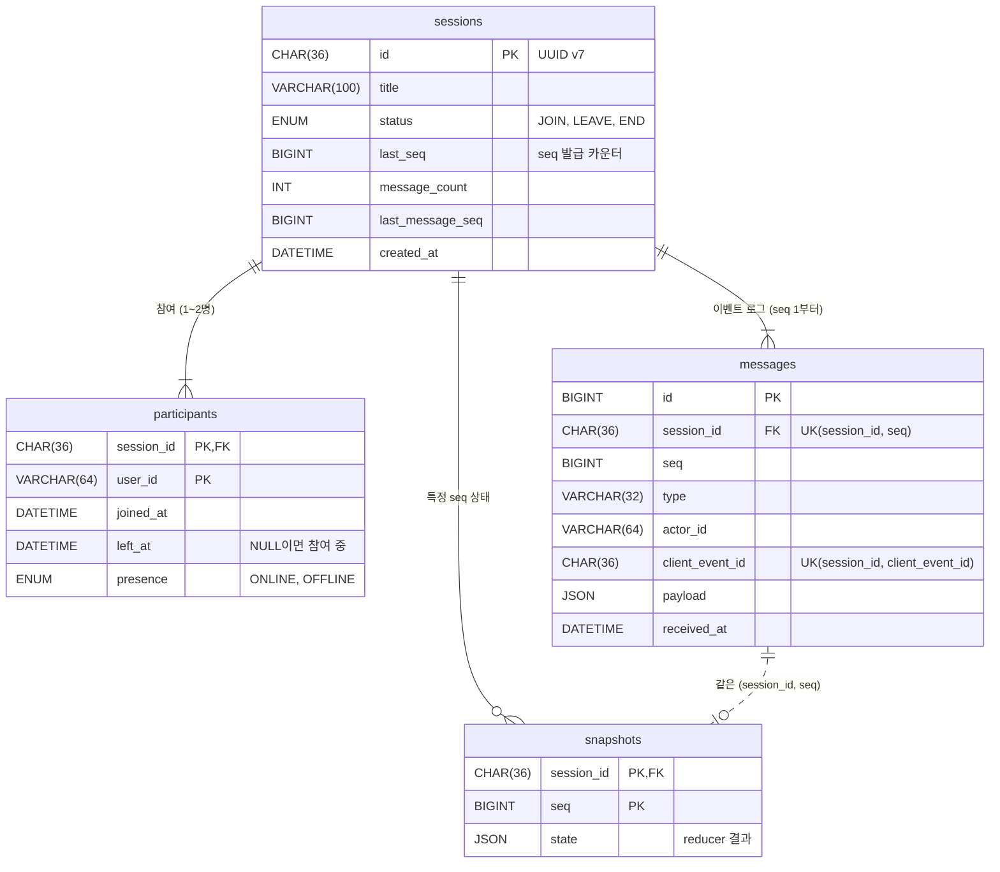

# DB 설계

MariaDB 기반 테이블 설계이다. API 명세는 [api.md](./api.md)를 참고한다.

## 1. 구성 개요

| 테이블 | 역할 | 성격 |
|---|---|---|
| `sessions` | 세션 현재 상태, 목록 조회용 | 프로젝션 |
| `participants` | 참여자별 현재 상태, presence | 프로젝션 |
| `messages` | 채팅 메시지와 시스템 메시지(입장, 퇴장, 종료, presence)의 원본 기록 | append-only, 사실의 원천 |
| `snapshots` | 특정 seq 시점의 상태 | 타임라인 복원 가속용 캐시 |

- `messages`는 이벤트 로그 역할을 한다. 채팅 본문(`MESSAGE_CREATED`)뿐 아니라 세션 상태와 presence를 바꾸는 시스템 메시지도 같은 테이블에 seq 순서로 저장한다. api.md와 코드에서 말하는 "이벤트"는 이 테이블의 한 행이다.
- 이벤트 저장과 프로젝션 갱신은 **같은 트랜잭션**에서 처리한다. 프로젝션이 이벤트보다 늦거나 앞서는 상황을 만들지 않는다.
- 프로젝션은 이벤트를 처음부터 다시 적용하면 언제든 재구성할 수 있어야 한다.

### 테이블 관계



- 모든 테이블은 `sessions`를 중심으로 1:N이다. 세션이 만들어질 때 `SESSION_CREATED`(seq 1)와 생성자의 `PARTICIPANT_JOINED`(seq 2)가 함께 저장되므로, 세션에는 참여자와 이벤트가 항상 1개 이상 있다.
- `participants`는 세션당 최대 2행이다. 나간 참여자도 행을 지우지 않고 `left_at`만 채운다.
- `snapshots`는 `messages`의 특정 seq 시점 상태다. FK는 `sessions`에만 걸고, `messages`와는 `(session_id, seq)` 값으로만 대응한다(점선). 스냅샷은 지워도 되는 캐시다.
- 사용자 테이블은 없다. `user_id`, `actor_id`, `created_by`는 `X-User-Id` 헤더 값을 그대로 저장한다.

## 2. 공통 규칙

- 엔진 `InnoDB`, 문자셋 `utf8mb4`, collation `utf8mb4_unicode_ci`
- 시각은 `DATETIME(3)`, **UTC**로 저장한다. DB 연결의 time zone을 `+00:00`으로 고정한다.
- 시각 컬럼에는 DB 기본값(`CURRENT_TIMESTAMP`)을 쓰지 않는다. 애플리케이션이 이벤트의 `received_at`을 넣어 이벤트와 프로젝션의 시각을 일치시킨다.
- 세션 ID는 UUID v7(`CHAR(36)`)을 사용한다. 시간순으로 증가해 InnoDB 클러스터드 인덱스에 순서대로 들어간다. 이벤트 ID는 `BIGINT AUTO_INCREMENT`를 사용한다.
- `JSON` 타입은 MariaDB에서 `LONGTEXT`의 별칭이다. 형식 검증은 `CHECK (JSON_VALID(...))`와 애플리케이션 양쪽에서 한다.
- ORM은 TypeORM을 사용한다. 엔티티는 도메인 모듈별 `entities/*.entity.ts`에 두고 `TypeOrmModule.forFeature()`로 등록한다. 마이그레이션은 `src/database/migrations/`에 둔다. `synchronize`는 끄고 스키마는 마이그레이션으로만 바꾼다.

## 3. 테이블

### `sessions`

```sql
CREATE TABLE sessions (
  id               CHAR(36)        NOT NULL,
  title            VARCHAR(100)    NOT NULL,
  status           ENUM('JOIN', 'LEAVE', 'END') NOT NULL DEFAULT 'JOIN',
  created_by       VARCHAR(64)     NOT NULL,
  last_seq         BIGINT UNSIGNED NOT NULL DEFAULT 0,
  participant_count TINYINT UNSIGNED NOT NULL DEFAULT 0,
  message_count    INT UNSIGNED    NOT NULL DEFAULT 0,
  last_message_seq BIGINT UNSIGNED NULL,
  created_at       DATETIME(3)     NOT NULL,
  ended_at         DATETIME(3)     NULL,
  updated_at       DATETIME(3)     NOT NULL,
  PRIMARY KEY (id),
  KEY idx_sessions_created (created_at, id),
  KEY idx_sessions_status_created (status, created_at, id)
) ENGINE=InnoDB DEFAULT CHARSET=utf8mb4 COLLATE=utf8mb4_unicode_ci;
```

| 컬럼 | 설명 |
|---|---|
| `title` | 세션 제목. 목록에 표시한다. `SESSION_CREATED` payload에도 담아 이벤트만으로 복원할 수 있게 한다. |
| `last_seq` | seq 발급 카운터. 세션 행을 `SELECT ... FOR UPDATE`로 잠근 뒤 `last_seq + 1`을 다음 seq로 쓰고, messages INSERT와 같은 트랜잭션에서 갱신한다. 조회 시 클라이언트가 놓친 이벤트가 있는지 비교하는 기준도 된다. |
| `participant_count` | 현재까지 join한 인원(나간 사람 포함). 최대 2. |
| `message_count` | `MESSAGE_CREATED` 수. reducer 상태의 `messageCount` |
| `last_message_seq` | 마지막 `MESSAGE_CREATED`의 seq. 메시지가 없으면 NULL. reducer 상태의 `lastMessage`는 이 seq로 messages를 조회해 만든다. |

- 이벤트를 저장할 때 reducer에 넣을 현재 상태는 `sessions` + `participants` + 마지막 메시지 한 건으로 만든다. 쓰기마다 이벤트를 재적용하지 않는다.

### `participants`

```sql
CREATE TABLE participants (
  session_id   CHAR(36)    NOT NULL,
  user_id      VARCHAR(64) NOT NULL,
  joined_at    DATETIME(3) NOT NULL,
  left_at      DATETIME(3) NULL,
  presence     ENUM('ONLINE', 'OFFLINE') NOT NULL DEFAULT 'OFFLINE',
  presence_at  DATETIME(3) NULL,
  PRIMARY KEY (session_id, user_id),
  KEY idx_participants_user (user_id, session_id),
  CONSTRAINT fk_participants_session FOREIGN KEY (session_id) REFERENCES sessions (id)
) ENGINE=InnoDB DEFAULT CHARSET=utf8mb4 COLLATE=utf8mb4_unicode_ci;
```

- `idx_participants_user`는 `GET /sessions?participantId=` 필터에 사용한다.
- `presence`, `presence_at`은 마지막 presence 이벤트의 결과다. 서버 시작 시 `presence = 'ONLINE'`인 행마다 `PRESENCE_OFFLINE`을 저장해 정리한다(단일 인스턴스 기준).
- 2명 제한은 세션 행 잠금 아래에서 reducer가 참여자 수(`participants` 행으로 만든 상태)로 검사한다. `participant_count`는 목록 조회용 프로젝션이다.

### `messages`

채팅 메시지와 시스템 메시지를 함께 저장한다. `type`으로 구분한다.

```sql
CREATE TABLE messages (
  id               BIGINT UNSIGNED NOT NULL AUTO_INCREMENT,
  session_id       CHAR(36)        NOT NULL,
  seq              BIGINT UNSIGNED NOT NULL,
  type             VARCHAR(32)     NOT NULL,
  actor_id         VARCHAR(64)     NOT NULL,
  client_event_id  CHAR(36)        NULL,
  payload          JSON            NOT NULL DEFAULT '{}',
  client_sent_at   DATETIME(3)     NULL,
  received_at      DATETIME(3)     NOT NULL,
  PRIMARY KEY (id),
  UNIQUE KEY uk_messages_session_seq (session_id, seq),
  UNIQUE KEY uk_messages_session_client_event (session_id, client_event_id),
  KEY idx_messages_session_received (session_id, received_at),
  CONSTRAINT fk_messages_session FOREIGN KEY (session_id) REFERENCES sessions (id),
  CONSTRAINT chk_messages_payload CHECK (JSON_VALID(payload))
) ENGINE=InnoDB DEFAULT CHARSET=utf8mb4 COLLATE=utf8mb4_unicode_ci;
```

| 컬럼 | 설명 |
|---|---|
| `seq` | 세션 안에서의 정식 순서. 1부터 빈틈없이 증가한다. |
| `type` | 채팅: `MESSAGE_CREATED` / 시스템: `SESSION_CREATED`, `PARTICIPANT_JOINED`, `PARTICIPANT_LEFT`, `PRESENCE_ONLINE`, `PRESENCE_OFFLINE`, `SESSION_ENDED` |
| `actor_id` | 이벤트를 일으킨 사용자. 생성은 생성자, presence는 연결/끊김이 일어난 사용자다. 모든 이벤트에 행위자가 있으므로 NULL을 허용하지 않는다. |
| `client_event_id` | 중복 방지 키. presence 등 서버가 만든 이벤트는 NULL (NULL은 UNIQUE 검사에서 서로 겹치지 않는다) |
| `client_sent_at` | 참고용. 정렬과 복원에 쓰지 않는다. |
| `received_at` | 서버 수신 시각. `timeline?at=` 기준 |

- `type`은 이벤트 종류가 늘어날 것을 고려해 `ENUM` 대신 `VARCHAR`로 두고 애플리케이션에서 검증한다.
- 이 테이블에는 `UPDATE`, `DELETE`를 하지 않는다.
- `uk_messages_session_seq`는 타임라인 복원(스냅샷 이후 이벤트)과 누락 조회(`GET /sessions/{id}/events?afterSeq=`)의 범위 조회에도 쓰인다.
- TypeORM은 MariaDB의 CHECK 제약을 생성하지 않으므로 `chk_messages_payload`는 마이그레이션에 직접 작성했다.

**타입별 payload**

| type | payload |
|---|---|
| `SESSION_CREATED` | `{ "title": "..." }` |
| `PARTICIPANT_JOINED` | `{}` |
| `PARTICIPANT_LEFT` | `{}` |
| `MESSAGE_CREATED` | `{ "content": "..." }` |
| `PRESENCE_ONLINE` | `{}` |
| `PRESENCE_OFFLINE` | `{}` |
| `SESSION_ENDED` | `{}` |

- presence는 소켓 단위가 아니라 사용자·세션 단위로 기록한다(여러 탭 중 첫 구독과 마지막 구독 종료). 그래서 `socketId`나 끊김 사유를 담지 않는다.

### `snapshots`

```sql
CREATE TABLE snapshots (
  session_id  CHAR(36)        NOT NULL,
  seq         BIGINT UNSIGNED NOT NULL,
  state       JSON            NOT NULL,
  created_at  DATETIME(3)     NOT NULL,
  PRIMARY KEY (session_id, seq),
  CONSTRAINT fk_snapshots_session FOREIGN KEY (session_id) REFERENCES sessions (id),
  CONSTRAINT chk_snapshots_state CHECK (JSON_VALID(state))
) ENGINE=InnoDB DEFAULT CHARSET=utf8mb4 COLLATE=utf8mb4_unicode_ci;
```

- `state`는 reducer가 만드는 세션 상태(상태, 참여자, presence, 메시지 수, 마지막 메시지)를 그대로 저장한다. 메시지 목록 전체는 넣지 않는다.
- messages로 언제든 다시 만들 수 있는 캐시다. 지워도 복원 결과는 같고 속도만 달라진다.

**기록 시점**: 아래 이벤트를 저장한 직후, 같은 트랜잭션에서 그 seq의 reducer 결과를 저장한다.

| 조건 | 대상 |
|---|---|
| 세션/참여 상태 변경 | `PARTICIPANT_JOINED`, `PARTICIPANT_LEFT`, `SESSION_ENDED` |
| 100개마다 | `seq % 100 = 0`인 이벤트 (타입 무관) |

- 두 조건이 같은 seq에서 겹쳐도 PK `(session_id, seq)`이므로 한 행만 저장한다.
- `SESSION_CREATED`(seq 1)는 빈 상태와 거의 같으므로 기록하지 않는다. presence 이벤트는 100개 조건에 걸릴 때만 기록된다.
- 기록 조건 판단은 순수 함수(`shouldSnapshot(event)`)로 두고 테스트한다.

## 4. 핫패스 쿼리와 인덱스

가장 자주 실행되는 쿼리 3개와, 각 쿼리가 빠르게 동작하도록 둔 인덱스를 정리한다.

모든 쿼리는 `session_id`로 먼저 범위를 좁힌다. 그래서 전체 세션이 아무리 많아도 **해당 세션의 행만** 읽는다.

### 4.1 메시지 저장 (메시지를 보낼 때마다)

가장 자주 실행되는 경로다. 한 트랜잭션 안에서 아래 순서로 실행한다.

```sql
-- ① 세션을 잠근다: 같은 세션의 저장을 한 줄로 세운다
SELECT * FROM sessions WHERE id = ? FOR UPDATE;
-- ② 이미 저장된 메시지인지 확인한다 (재전송 중복 방지)
SELECT * FROM messages WHERE session_id = ? AND client_event_id = ?;
-- ③ 현재 상태를 읽는다: 참여자 2명과 마지막 메시지
SELECT * FROM participants WHERE session_id = ?;
SELECT * FROM messages WHERE session_id = ? AND seq = ?;
-- ④ 저장한다
INSERT INTO messages ...;  UPDATE sessions ...;
```

| 단계 | 쓰는 인덱스 | 이유 |
|---|---|---|
| ① 잠금 | `sessions` PK | 세션 한 행만 잠근다. 다른 세션의 저장은 기다리지 않는다. |
| ② 중복 확인 | `uk_messages_session_client_event` | 한 번에 찾는다. 같은 메시지가 동시에 두 번 와도 UNIQUE 제약이 두 번째 저장을 막는다. |
| ③ 참여자 | `participants` PK `(session_id, user_id)` | 세션의 참여자 2명을 바로 찾는다. 같은 사용자가 한 세션에 두 번 들어가지 않게 구분하는 키이기도 하다. |
| ③ 마지막 메시지 | `uk_messages_session_seq` | 마지막 메시지 한 건만 읽는다. 지난 메시지를 전부 다시 읽지 않는다. |

**느려질 수 있는 곳:** 같은 세션의 저장은 잠금 때문에 하나씩 처리된다. 그래서 트랜잭션 안의 쿼리를 모두 "인덱스로 한 번에 찾기"로 만들어 잠금 시간을 짧게 했다. 1:1 채팅은 한 세션에 메시지가 몰리지 않아 문제가 되지 않는다.

### 4.2 빠진 메시지 조회 (다시 연결할 때마다)

`GET /sessions/{id}/events?afterSeq=`. 마지막으로 받은 번호(seq) 다음부터 가져온다.

```sql
SELECT * FROM messages WHERE session_id = ? AND seq > ? ORDER BY seq LIMIT ?;
```

| 쓰는 인덱스 | 이유 |
|---|---|
| `uk_messages_session_seq` | 인덱스가 이미 seq 순서로 정렬되어 있어, 빠진 부분부터 필요한 만큼만 차례로 읽는다. 따로 정렬하지 않는다. |

**느려질 수 있는 곳:** 오래 끊겼던 사용자는 빠진 메시지가 많다. 한 번에 최대 500개까지만 주고, 나머지는 이어서 요청하게 한다(`hasMore`).

### 4.3 특정 시점 상태 복원

`GET /sessions/{id}/timeline?at=`. 그 시각의 세션 상태를 다시 계산한다.

```sql
-- ① 그 시각까지 저장된 마지막 번호(seq)를 찾는다
SELECT MAX(seq) FROM messages WHERE session_id = ? AND received_at <= ?;
-- ② 그 번호 이전의 가장 가까운 스냅샷(저장해 둔 상태)을 읽는다
SELECT * FROM snapshots WHERE session_id = ? AND seq <= ? ORDER BY seq DESC LIMIT 1;
-- ③ 스냅샷 이후의 메시지만 읽어 상태에 다시 적용한다
SELECT * FROM messages WHERE session_id = ? AND seq BETWEEN ? AND ? ORDER BY seq;
```

| 단계 | 쓰는 인덱스 | 이유 |
|---|---|---|
| ① 마지막 번호 | `idx_messages_session_received` | 시각 기준으로 범위를 찾는다. |
| ② 스냅샷 | `snapshots` PK `(session_id, seq)` | 기준 번호 바로 앞의 스냅샷 한 건을 찾는다. |
| ③ 다시 적용 | `uk_messages_session_seq` | 스냅샷 이후 구간만 읽는다. |

**느려질 수 있는 곳**
- 스냅샷이 없으면 처음부터 모든 메시지를 다시 계산해야 한다. 그래서 입장·퇴장·종료 때와 100개마다 스냅샷을 남긴다. 다시 계산하는 메시지는 많아야 99개다.
- ①은 그 시각 이전 메시지를 모두 훑는다. 세션당 메시지가 수천 개 수준이면 괜찮지만, 아주 긴 세션의 복원이 느려지면 인덱스를 `(session_id, received_at, seq)`로 바꾼다(미적용).
