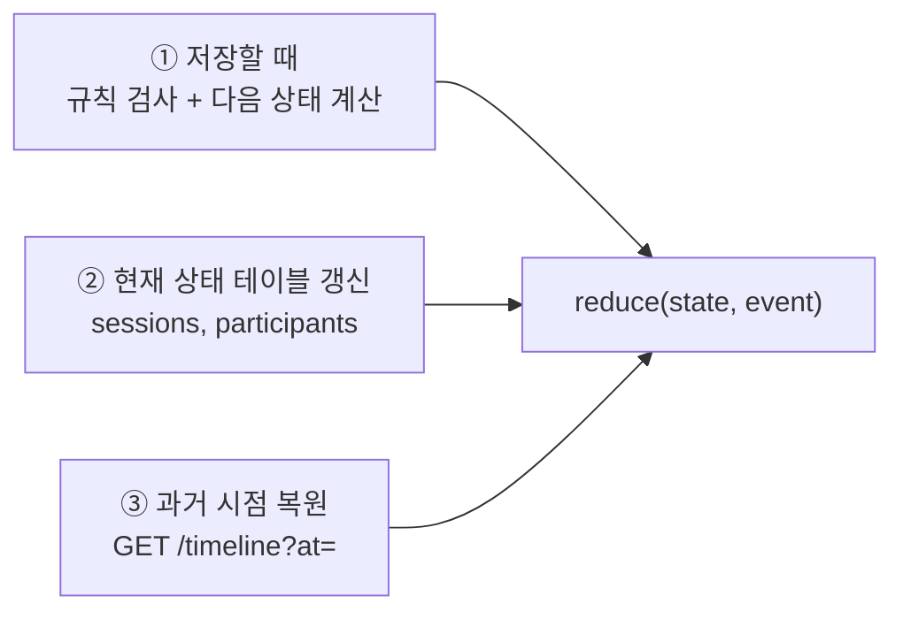

# 이벤트 기반 상태 복원

세션에서 일어난 모든 일을 이벤트로 기록하고, 이벤트를 순서대로 다시 계산해 **원하는 시점의 세션 상태**를 만든다. 이 문서는 그 설계와 구현 결과를 정리한다. API 형식은 [api.md](./api.md), 테이블은 [db.md](./db.md)를 참고한다.

## 1. 핵심 아이디어

> **상태는 저장하는 것이 아니라 이벤트로부터 계산하는 것이다.**

- 세션에서 일어난 일(생성, 입장, 메시지, 접속, 퇴장, 종료)은 모두 `messages` 테이블에 한 줄씩 쌓인다. 수정하거나 지우지 않는다.
- 각 이벤트는 세션 안에서 1, 2, 3… 순서 번호(`seq`)를 받는다.
- "어떤 시점의 상태"는 그 시점까지의 이벤트를 **1번부터 순서대로 계산**한 결과다.

```
이벤트:  #1 생성 → #2 A 입장 → #3 B 입장 → #4 A 메시지 → #5 B 퇴장 → #6 종료
상태:      JOIN      A          A, B         메시지 1개      LEAVE        END
```

같은 이벤트를 같은 순서로 계산하면 언제나 같은 상태가 나온다. 그래서 과거 어느 시점이든 다시 만들 수 있다.

## 2. 상태와 계산 함수

### 세션 상태

| 항목 | 의미 |
|---|---|
| `status` | 세션 상태. `JOIN`(진행 중) → `LEAVE`(누군가 나감) → `END`(종료) |
| `participants` | 참여자 목록(최대 2명). 입장 시각, 퇴장 시각, 접속 상태(`ONLINE`/`OFFLINE`) |
| `messageCount` | 지금까지 보낸 메시지 수 |
| `lastMessage` | 마지막 메시지 (번호, 보낸 사람, 내용, 시각) |

메시지 전체 목록은 상태에 넣지 않는다. 상태를 작게 유지해야 스냅샷(4장)도 작아진다. 메시지 목록은 이벤트를 조회하면 된다.

### 계산 함수 (reducer)

```ts
reduce(지금 상태, 이벤트) → 다음 상태
```

`src/session/session.reducer.ts`에 있다. 이벤트 하나를 받아 다음 상태를 돌려주는 함수다.

- **순수 함수다.** DB나 현재 시각을 읽지 않는다. 같은 입력이면 항상 같은 결과다.
- **규칙도 여기서 검사한다.** 허용되지 않는 이벤트(정원 초과 입장, 나간 사람의 메시지 등)는 에러를 낸다.

| 이벤트 | 상태 변화 |
|---|---|
| `SESSION_CREATED` | 상태가 `JOIN`이 된다 |
| `PARTICIPANT_JOINED` | 참여자 추가 (최대 2명) |
| `MESSAGE_CREATED` | 메시지 수 + 1, 마지막 메시지 갱신 |
| `PRESENCE_ONLINE` / `OFFLINE` | 그 참여자의 접속 상태만 바뀜 |
| `PARTICIPANT_LEFT` | 상태가 `LEAVE`, 퇴장 시각 기록 |
| `SESSION_ENDED` | 상태가 `END` |

### 한 함수를 세 곳에서 쓴다



저장할 때, 현재 상태를 갱신할 때, 과거 상태를 복원할 때 **같은 함수**를 쓴다. 그래서 "실시간으로 본 상태"와 "나중에 복원한 상태"가 어긋날 수 없다.

## 3. 저장: 이벤트와 상태를 함께 기록

메시지 하나를 저장할 때 아래를 **한 트랜잭션**으로 처리한다. 하나라도 실패하면 전부 취소된다.

1. 세션을 잠근다. 같은 세션의 저장은 한 줄로 선다.
2. 같은 메시지가 이미 저장됐는지 확인한다(`clientEventId`).
3. 현재 상태를 읽고, `reduce`로 다음 상태를 계산한다. 규칙에 어긋나면 여기서 멈춘다.
4. 다음 번호(`seq = 마지막 번호 + 1`)를 붙여 이벤트를 저장한다.
5. 현재 상태 테이블(`sessions`, `participants`)을 갱신한다.
6. 필요하면 스냅샷을 저장한다(4장).

- 순서는 **서버가 붙인 번호(seq)** 로만 정한다. 클라이언트가 보낸 시각은 기기마다 달라서 쓰지 않는다.
- 늦게 도착한 메시지는 도착한 순서대로 번호를 받는다. 과거 위치에 끼워 넣지 않는다. 그래서 이미 복원한 과거 상태가 나중에 바뀌지 않는다.

## 4. 스냅샷: 복원을 빠르게

이벤트가 1,000개인 세션을 매번 1번부터 계산하면 느리다. 그래서 중간중간 **계산 결과(상태)를 저장해 둔다.** 이것이 스냅샷이다.

| 언제 저장하나 | 이유 |
|---|---|
| 입장, 퇴장, 종료 직후 | 세션 상태가 크게 바뀌는 시점 |
| 이벤트 100개마다 (`seq`가 100의 배수) | 메시지만 계속 쌓여도 다시 계산할 양을 100개 미만으로 제한 |

- 스냅샷은 **캐시**다. 지워도 이벤트로 다시 계산할 수 있고, 결과는 같다. 속도만 느려진다.
- 생성 이벤트(#1)는 빈 상태와 거의 같아 저장하지 않는다.
- 조건 판단은 `shouldSnapshot(event)` 함수 하나에 있다(`src/projection/snapshot-policy.ts`).

## 5. 복원: `GET /sessions/{id}/timeline?at=`

`at` 시각의 세션 상태를 돌려준다. `src/projection/projection.service.ts`의 `restoreTimeline()`이 처리한다.

**복원 순서**

1. **기준 번호 찾기:** `at` 시각까지 서버가 받은 이벤트 중 가장 큰 번호(seq)를 찾는다.
2. **가장 가까운 스냅샷 읽기:** 기준 번호 이하의 스냅샷 중 가장 최근 것을 읽는다. 없으면 빈 상태에서 시작한다.
3. **나머지 계산:** 스냅샷 다음 이벤트부터 기준 번호까지 `reduce`로 계산한다.

**예시**

| seq | 시각 | 이벤트 | 스냅샷 |
|---|---|---|---|
| 1 | 10:00:00 | A가 세션 생성 | |
| 2 | 10:00:00 | A 입장 | ✅ |
| 3 | 10:01:00 | B 입장 | ✅ |
| 4 | 10:02:00 | A 접속 (ONLINE) | |
| 5 | 10:03:00 | A "안녕하세요" | |
| 6 | 10:04:00 | B "네, 안녕하세요" | |
| 7 | 10:05:00 | B 퇴장 | ✅ |
| 8 | 10:06:00 | A가 종료 | ✅ |

| 요청한 시각 (`at`) | 기준 번호 | 계산 방법 | 결과 |
|---|---|---|---|
| 10:04:30 | 6 | 스냅샷 #3 + 이벤트 #4~#6 계산 | `JOIN`, A ONLINE·B OFFLINE, 메시지 2개, 마지막 메시지 #6 |
| 10:05:30 | 7 | 스냅샷 #7을 그대로 사용 | `LEAVE`, B 퇴장 시각 10:05:00 |
| 11:00:00 | 8 | 스냅샷 #8을 그대로 사용 | `END` (현재 상태와 같음) |
| 09:59:00 | 없음 | — | `404 SESSION_NOT_FOUND` (세션 생성 전) |

**응답 예**

```json
{
  "sessionId": "0192a3b4-...",
  "at": "2026-10-20T10:04:30.000Z",
  "seq": 6,
  "state": {
    "status": "JOIN",
    "participants": [
      { "userId": "A", "joinedAt": "2026-10-20T10:00:00.000Z", "leftAt": null, "presence": "ONLINE" },
      { "userId": "B", "joinedAt": "2026-10-20T10:01:00.000Z", "leftAt": null, "presence": "OFFLINE" }
    ],
    "messageCount": 2,
    "lastMessage": { "seq": 6, "actorId": "B", "content": "네, 안녕하세요", "receivedAt": "2026-10-20T10:04:00.000Z" }
  }
}
```

**같은 시각은 언제 조회해도 같은 결과다.** 기준 번호 이하의 이벤트와 스냅샷은 바뀌지 않기 때문이다(이벤트는 수정·삭제하지 않고, 새 이벤트는 항상 더 큰 번호를 받는다).

## 6. 구현 결과

### 구현 위치

| 역할 | 파일 |
|---|---|
| 상태 계산 (reducer, 다시 계산 `replay`) | `src/session/session.reducer.ts` |
| 이벤트·상태·스냅샷 저장 (한 트랜잭션) | `src/event/event.service.ts` |
| 스냅샷 저장 조건 | `src/projection/snapshot-policy.ts` |
| 시점 복원 | `src/projection/projection.service.ts` |
| 복원 API | `src/session/session.controller.ts` (`GET /sessions/{id}/timeline`) |

### 검증

| 확인한 것 | 테스트 |
|---|---|
| 이벤트별 상태 변화와 규칙 위반 에러 | reducer 단위 테스트 |
| 스냅샷 저장 조건 (입장·퇴장·종료, 100개마다) | `shouldSnapshot` 단위 테스트, 통합 테스트 |
| 이벤트 104개짜리 세션에서, **모든 이벤트 시각**의 복원 결과가 1번부터 다시 계산한 결과와 같음 | 통합 테스트 (`projection.service.int-spec.ts`) |
| **스냅샷을 모두 지워도** 복원 결과가 같음 | 통합 테스트 |
| 현재 상태 테이블이 이벤트를 다시 계산한 결과와 같음 | 통합 테스트 (`event.service.int-spec.ts`) |
| 마지막 이벤트 이후 시각은 현재 상태, 세션 생성 전 시각은 404 | 통합·e2e 테스트 |
| 실제 서버에서 입장 직후, 메시지 후, 퇴장 후, 종료 후 시점의 상태 | e2e 테스트 (`flow.e2e-spec.ts`) |

전체 결과는 [test-report.md](./test-report.md)에 있다.

## 7. 한계와 선택

| 항목 | 선택 | 이유 / 영향 |
|---|---|---|
| 시점 기준 | 서버가 받은 시각(`received_at`) | 클라이언트 시각은 기기마다 달라 믿을 수 없다. 대신 "사용자가 보낸 시각"이 아니라 "서버가 받은 시각" 기준의 상태다. |
| 늦게 온 이벤트 | 도착 순서대로 번호 부여 | 과거 상태가 바뀌지 않는다. 대신 오프라인 중 쓴 메시지는 받은 시점에 들어간다. |
| 상태 범위 | 메시지 목록 제외 | 스냅샷이 작다. 그 시점의 메시지 목록이 필요하면 이벤트를 조회한다. |
| 시각 정밀도 | 밀리초 | 같은 밀리초에 저장된 이벤트(생성 #1, #2)는 함께 포함된다. |
| 아주 긴 세션 | 기준 번호 찾기가 그 시각 이전 이벤트를 훑음 | 세션당 수천 건까지는 문제없다. 느려지면 인덱스를 바꾼다([db.md](./db.md) 4.3). |
